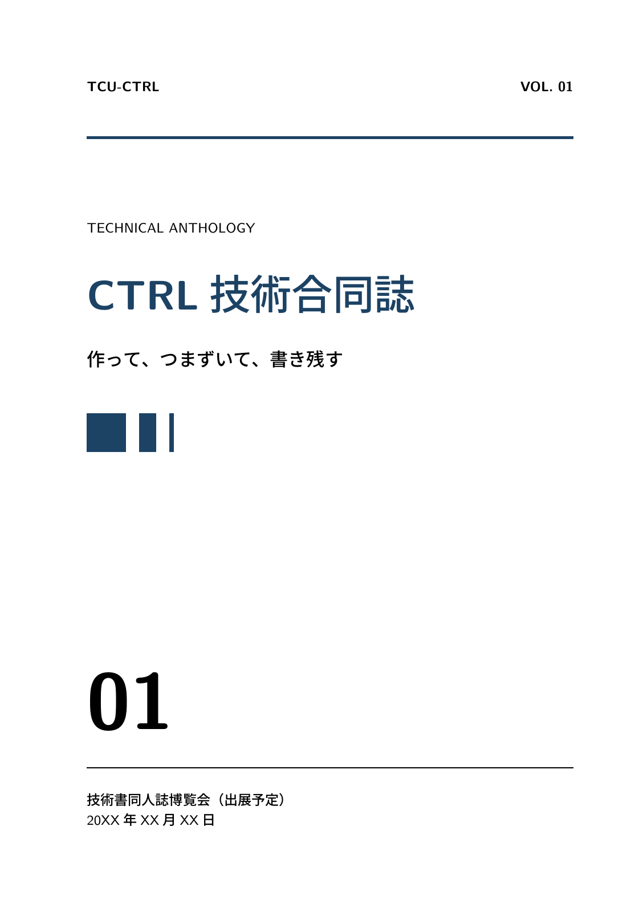
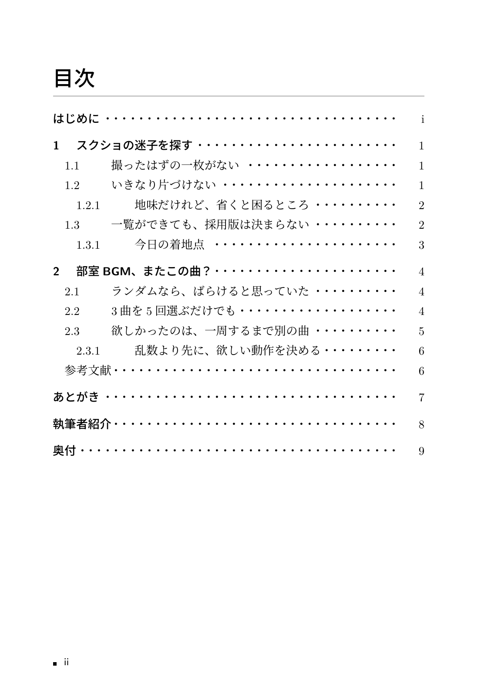
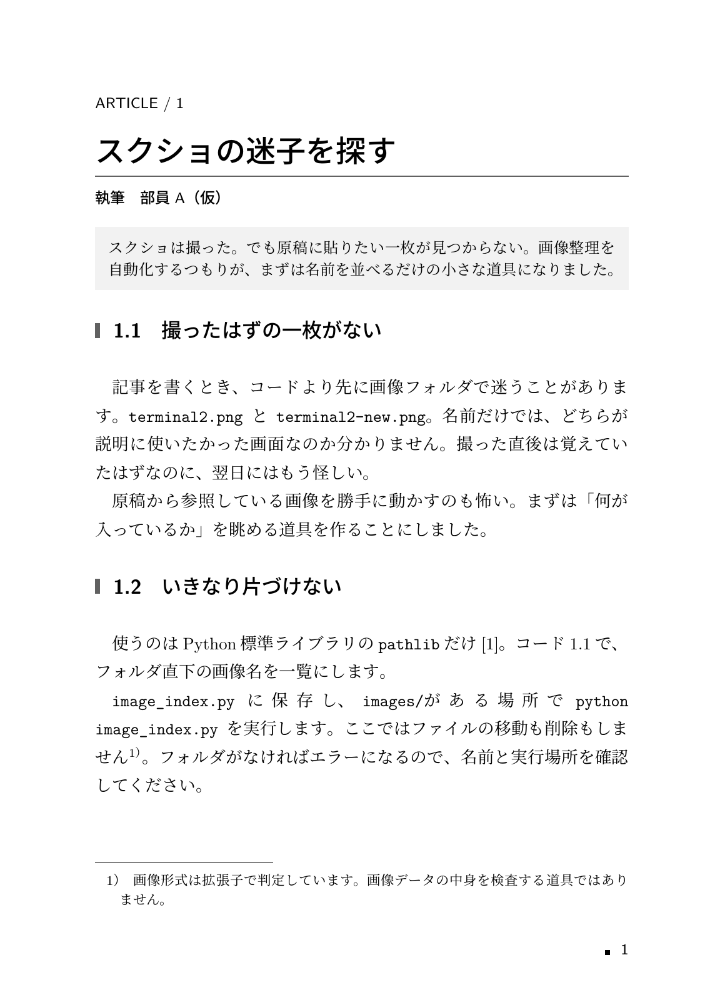
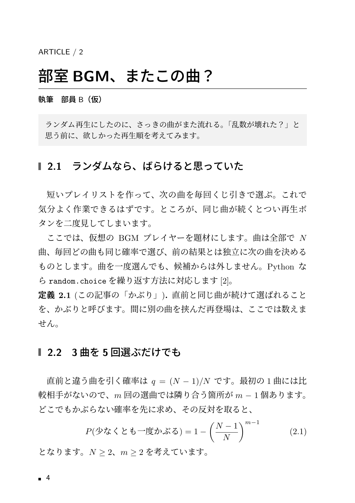
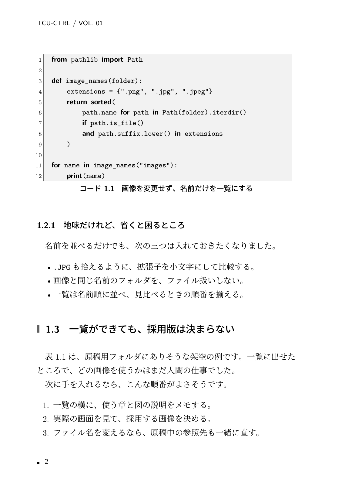
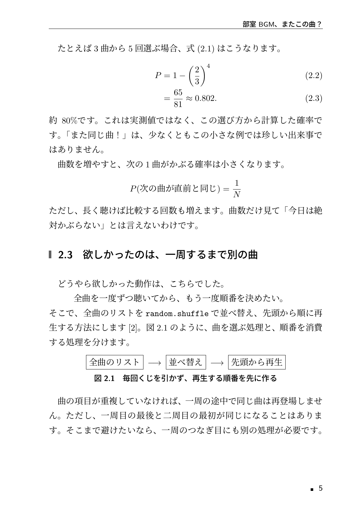
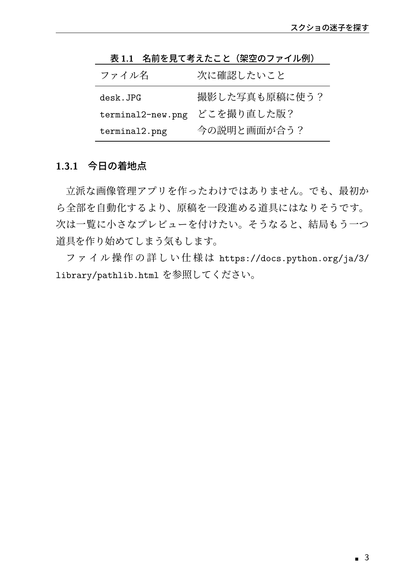
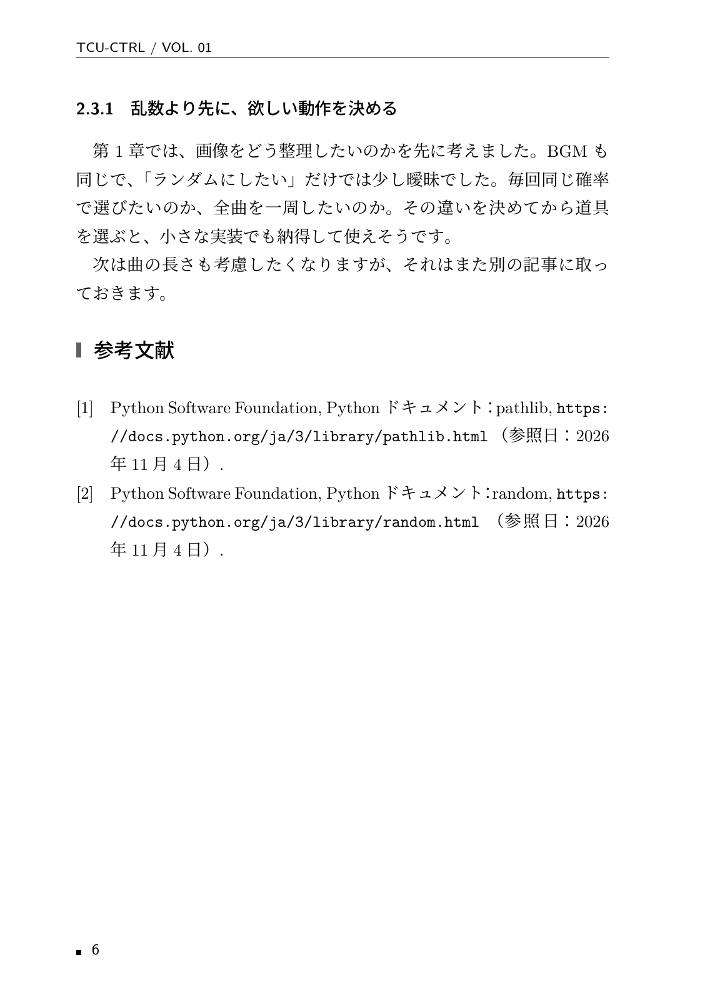

# TCU-CTRL 技術合同誌

技術書同人誌博覧会（技書博）へのサークル出展に向けて、TCU-CTRLの部員が技術記事を持ち寄り、1冊の合同誌を制作するためのリポジトリです。

## 制作方針

- 日本語・横書き・A5判・両面印刷を想定します。
- 目標ページ数は48〜64ページです。ページ数は原稿に合わせて調整します。
- 部員ごとに章を担当し、章単位の原稿ファイルで共同執筆します。
- 本文は原則モノクロ、表紙はカラーにも対応します。
- デザインよりも、安定した日本語組版と保守しやすさを優先します。

## 使用技術

- LuaLaTeX：日本語本文・数式の組版
- jlreq：日本語書籍のレイアウト
- latexmk / Makefile：PDF生成
- Git / GitHub：原稿管理・レビュー

## PDFの生成

TeX Live（macOSではMacTeX）とlatexmkを用意してください。
環境構築・章追加・数式・コード・画像の掲載方法は [執筆ガイド](techbook/README.md) に記載しています。

macOS/Linux（makeを使用）：

```sh
cd techbook
make pdf
```

Windowsのコマンドプロンプト（makeは不要）：

```bat
cd techbook
build.cmd pdf
```

Docker Desktopを使用する場合（ホストへのTeXインストールは不要）：

```sh
cd techbook
docker compose build
docker compose run --rm tex
```

VS Codeではリポジトリのルートを開き、Dev Containers拡張の **Reopen in Container** を実行できます。
詳細は [Windows・Docker・Dev Containerの手順](techbook/README.md#利用環境の選び方) を参照してください。

生成先は `techbook/build/main.pdf` です。`make clean`、`build.cmd clean`、または `docker compose run --rm tex make clean` で生成物を削除できます。
PDFや補助ファイルはGit管理対象外です。

表紙・はじめに・目次・サンプル2章・参考文献・あとがき・執筆者紹介・奥付を収録しています。
書名や発行情報は `techbook/metadata.tex`、版面は `techbook/layout.tex` で変更できます。

## 紙面サンプル

サンプル原稿から生成したA5判・1段組の紙面です。記事タイトル・著者名・紹介文をまとめた冒頭と、モノクロの見出し・コード欄を共通デザインにしています。
記事は「スクショの迷子を探す」と「部室BGM、またこの曲？」の2本です。
身近な困りごとから、小さな道具を作ったり、欲しい動作を考え直したりする内容にしています。
場面・筆者・ファイル例は架空のサンプルです。

| 表紙 | 目次 |
| --- | --- |
|  |  |

| スクショ整理の小さな道具 | BGMの選び方と確率 |
| --- | --- |
|  |  |

| Pythonの実装 | 図・選曲の工夫 |
| --- | --- |
|  |  |

| 画像候補と制作メモ | 記事の着地点・参考文献 |
| --- | --- |
|  |  |

## 共同執筆の進め方

1. 担当する章と記事のテーマを部内で決めます。
2. 作業用ブランチで原稿と画像を追加します。
3. PDFを生成して紙面を確認します。
4. Pull Requestで内容と組版をレビューします。

発行日、正式な書名、印刷会社、入稿仕様は今後確定します。
